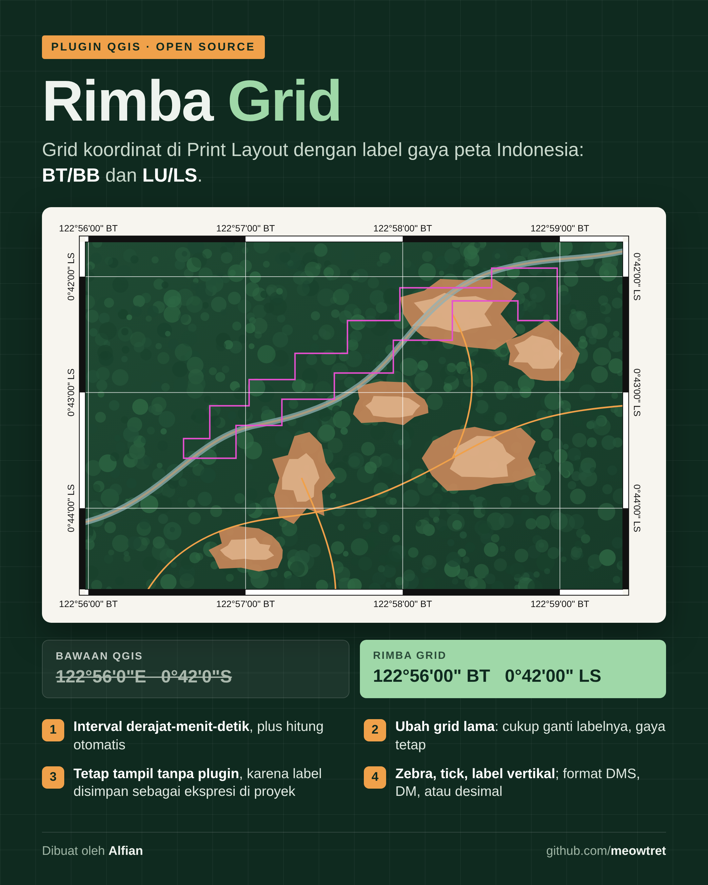
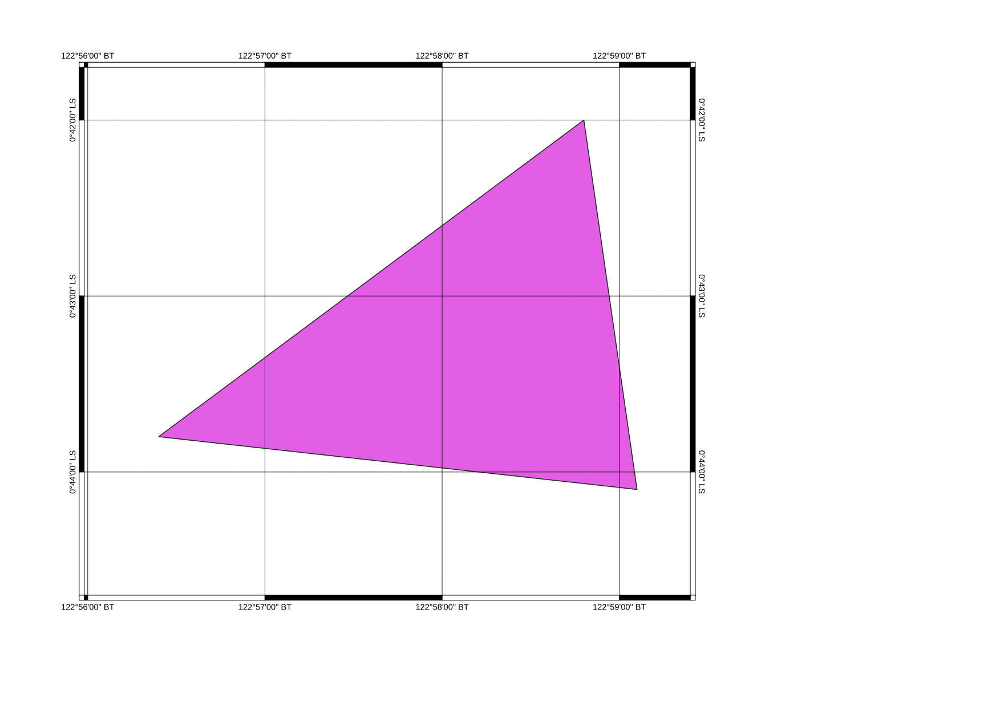

# Rimba Grid

Plugin QGIS untuk membuat grid koordinat di **Print Layout** dengan label gaya peta Indonesia:
**BT/BB** (Bujur Timur/Bujur Barat) dan **LU/LS** (Lintang Utara/Lintang Selatan).

| Bawaan QGIS | Rimba Grid |
|---|---|
| `122°56'0"E` · `0°42'0"S` | `122°56'00" BT` · `0°42'00" LS` |

## Fitur

- Buat grid geografis (EPSG:4326) baru pada item peta, atau ubah grid yang sudah ada.
- Mode **Hanya ganti label**: interval, bingkai, dan huruf grid lama dipertahankan.
- Interval diisi dalam derajat-menit-detik, dengan tombol hitung otomatis dari luas peta.
- Format DMS, derajat-menit, atau derajat desimal, dengan pemisah desimal koma atau titik.
- Opsi spasi antar komponen dan detik tanpa nol depan, untuk format seperti `122° 33' 0" BT`.
- Bingkai zebra, zebra nautikal, garis tepi, atau tick. Label LU/LS vertikal di sisi kiri-kanan.
- Label disimpan sebagai **ekspresi kustom** grid layout, jadi proyek tetap tampil benar walau dibuka tanpa plugin.
- Perubahan bisa dibatalkan (Ctrl+Z) di Layout Designer.

## Pemasangan

**Dari ZIP**

1. Unduh ZIP dari halaman [Releases](https://github.com/meowtret/rimba_grid/releases), atau buat sendiri dengan men-zip folder `rimba_grid/`.
2. QGIS → **Plugins → Manage and Install Plugins → Install from ZIP**.

## Cara pakai

1. Buat layout dan item peta.
2. Klik ikon **Rimba Grid** (di toolbar QGIS atau toolbar Layout Designer).
3. Pilih layout, item peta, dan grid (baru atau yang sudah ada).
4. Atur interval, format label, dan tampilan, lalu klik **Terapkan**.

## Kompatibilitas

QGIS 3.16 – 4.x (kode sudah memakai enum gaya Qt6). Diuji di QGIS 3.34.

## Lisensi

GPL-2.0 atau yang lebih baru. Lihat [LICENSE](LICENSE).
